<!-- animated contribution graph (regenerated daily by .github/workflows/update-profile-art.yml) -->

<h3><code>kanha@github ~ $ ./contributions.sh</code></h3>

 
 

<!-- ascii portrait + streak/stats card (equal 840x880 canvases) -->

<h3><code>kanha@github ~ $ whoami</code></h3>

<table>
<tr>
<td valign="top"></td>
<td valign="top"></td>
</tr>
</table>

 
 

<h3><code>kanha@github ~ $ ./links.sh</code></h3>

<b>AI partnerships and product lead</b>

 

<code>kanha@github ~ $ ls projects/</code>

 

| Project | | |
|---|---|---|
| [HeartMetrics](https://github.com/kjodhpur/v0-manager-os-prototype) | Past project — AI workplace analytics | [live](https://heartmetrics.dev) |
| [HomeLens AI](https://github.com/kjodhpur/HomeLensAI) | NLP early-warning from review text | [demo](https://homelensai.vercel.app) |
| [GrantI](https://github.com/kjodhpur/GrantI) | Foundation ranking from IRS 990-PF | [app](https://granti-rouge.vercel.app) |
| [Gentle Weapons PLPs](https://github.com/kjodhpur/gentle-weapons-plp) | Personalized prospect landing sites | [demo](https://gentle-weapons-plp.vercel.app) |
| [Events](https://github.com/kjodhpur/events-portfolio) | Event portfolio + admin CMS | [site](https://events-portfolio-ivory.vercel.app) |

 
 

<!-- contribution snake — kept from prior setup -->

<h3><code>kanha@github ~ $ ./snake.sh</code></h3>

  <picture>
    <source media="(prefers-color-scheme: dark)" srcset="https://raw.githubusercontent.com/kjodhpur/kjodhpur/output/github-contribution-grid-snake-dark.svg" />
    <source media="(prefers-color-scheme: light)" srcset="https://raw.githubusercontent.com/kjodhpur/kjodhpur/output/github-contribution-grid-snake.svg" />
    
  </picture>

